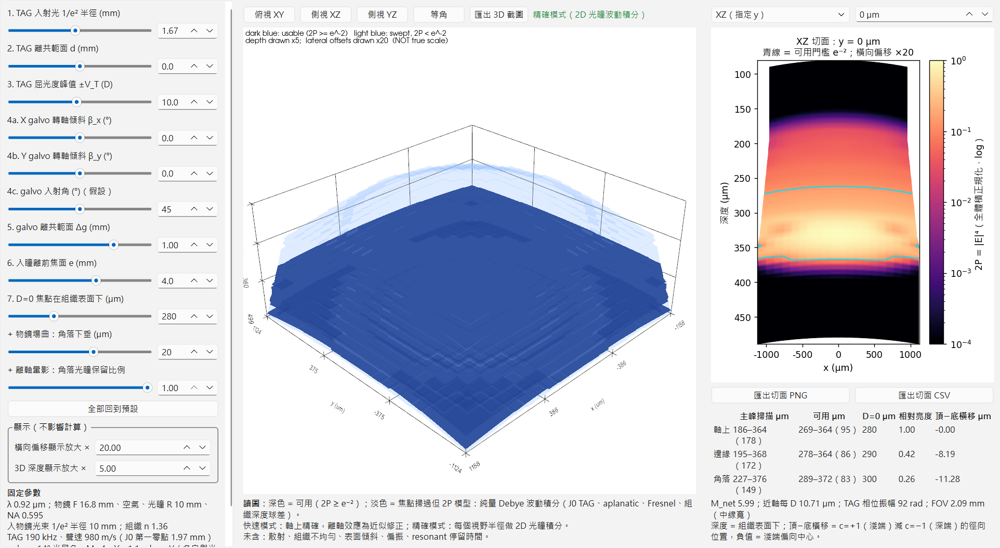

# TAG Scan-Volume Explorer

Interactive desktop tool for the volume swept by the two-photon focus of a **TAG-lens + two-galvo** microscope. Move a slider and the 3-D scan volume, the slices and the numbers update. Usable regions (2P ≥ e⁻² of the brightest point) are drawn dark; regions the focus passes but where 2P < e⁻² are drawn transparent.

互動式桌面工具：TAG lens ＋ 雙 galvo 雙光子顯微鏡的焦點掃描體積。拖動參數，3D 體積、切面與數字會即時更新。深色＝可用區（2P ≥ 全體積最亮點的 e⁻²），淡色＝焦點掃過但 2P < e⁻²。



## Install / 安裝

```bash
git clone https://github.com/dorisericchatgpt-Gemeni/tag-scan-explorer.git
cd tag-scan-explorer
python -m venv .venv
.venv\Scripts\activate          # macOS/Linux: source .venv/bin/activate
pip install -r requirements.txt
pip install -e .
python -m tagscan
```

Python ≥ 3.10. Tested on Windows 11 (PySide6 6.12, PyVista 0.49).

## Pages / 分頁

* **TAG 掃描** — depth from the TAG lens (all parameters below).
* **Piezo 掃描** — depth from a piezo moving the objective (no TAG). Same 3-D view, slices, export and numbers; extra parameter: piezo travel ±µm. Because the whole converging cone translates, non-telecentricity and galvo offset cause (almost) no lean or shear here — only dimming — unlike the TAG page.

## Adjustable parameters / 可調參數

| # | Parameter | Meaning |
|---|---|---|
| 1 | TAG beam 1/e² radius w_TAG | relay magnification follows: M = 10 mm / w_TAG (beam at the objective fixed at 10 mm) |
| 2 | TAG offset d | TAG lens displaced from the plane conjugate to the pupil (TAG space; d > 0 = laser side) |
| 3 | TAG power ±V_T | peak optical power in dioptres |
| 4 | galvo axis tilt β_x, β_y (+ incidence angle) | rotation axis not perpendicular to the plane of incidence → scan bow |
| 5 | galvo offsets Δg_x, Δg_y | each galvo off its pupil-conjugate plane → beam walks on the pupil (shear + dimming). If the two differ, the shear is no longer radial |
| 6 | entrance-pupil offset e | 0 = telecentric; F = stop at the lens → chief-ray tilt (scan lines lean) |
| 7 | depth of the D = 0 focus | below the tissue surface; sets the depth-dependent spherical aberration |
| + | field curvature | corner sag of the objective's focal surface |
| + | vignetting | fraction of the pupil kept at the field corner |

Fixed (edit `Fixed` in `tagscan/model.py`; the GUI panel reads it): λ 0.94 µm; objective F 16.8 mm, air, pupil radius 10 mm (NA 0.595); beam 1/e² radius 10 mm at the pupil; tissue n 1.36; TAG 190 kHz, sound speed 980 m/s; galvo ±14° optical, scan/tube-lens magnification 4; usable threshold e⁻².

## Model / 模型

Scalar Debye wave integral (`tagscan/tag_unified_psf.py`, extended in `tagscan/model.py`): Gaussian beam, true J0 TAG phase, aplanatic √cos weighting, air→tissue Fresnel transmission, propagation with k_z in tissue (depth-dependent spherical aberration included).

* **Fast mode** (while dragging, ~0.3 s): exact 1-D radial integral on axis; off-axis effects are corrections (lean from the chief-ray angle, shear from a first-order perturbation of the decentred TAG phase, dimming from pupil integrals). The shear is within about 10 % of the precise mode for galvo offsets up to 1 mm and about 20 % too large at 2 mm, where clipping shortens the sweep.
* **Precise mode** (after you release, a few seconds, background thread): full 2-D pupil integral at several field radii — tilted cone, decentred TAG phase, clipped pupil.
* Galvo geometry: exact vector reflection through X galvo → 1:1 relay → Y galvo.

Notes:

* Non-telecentricity does **not** curve the focal surface. It tilts the scan lines and makes the magnification depth dependent. Field curvature is a separate parameter.
* An ideal two-galvo scanner with an f·tanθ objective has ≈3 % pincushion at the corners (x ∝ tanθx / cosθy). This is geometric and is not a bow.
* The volume is max over a continuous TAG sweep. Sampled phases are interpolated, so no dark stripes appear between samples. The display can be switched to the time average over the sweep, which includes the longer dwell at the two ends of the sinusoidal sweep (the piezo page assumes a sinusoidal drive too). The numbers table always uses the peak.
* The ends of the usable range are interpolated between the sampled TAG phases (25 phases alone would quantise them by about 6 µm).
* **Spherical aberration decides where the usable range sits.** The objective is taken as perfect in air and focuses straight into tissue: no cover glass, cranial window or correction collar. At the default depth (279.6 µm) the 2P peak of the D = 0 focus is 18 % of its aberration-free value, the brightest point is at a diverging TAG phase (the J0 quartic term cancels part of the aberration there) and only the deeper half of the sweep is usable. At 50 µm depth the usable range is nearly symmetric. The numbers panel prints this ratio and warns below 50 %.

Not included: scattering, tissue inhomogeneity, tilted tissue surface, polarisation (vector) effects, cover glass / cranial window and any spherical-aberration correction, dwell-time weighting of the galvos, objective aberrations other than field curvature.

## Tests

```bash
pip install pytest
python -m pytest -q tests
```

The tests check four things:

* The model reproduces `tag_unified_psf` on axis.
* The fast and precise modes agree.
* The galvo-offset shear matches an independent 2-D wave calculation.
* The Hankel propagation matches a 2-D FFT angular-spectrum reference.

## License

MIT
